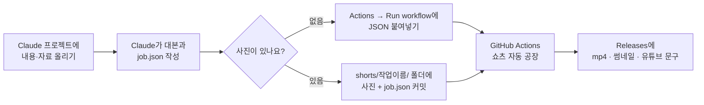

# 🏭 "[GitHub] 쇼츠 자동 공장" Claude 프로젝트 설정 (약 3분)

## 1. 프로젝트 만들기
1. [claude.ai](https://claude.ai) 왼쪽 메뉴에서 **Projects → + New project**를 누릅니다.
2. 이름에 `[GitHub] 쇼츠 자동 공장`을 넣고, 설명에 `내용과 자료를 올리면 yotasa-shorts-studio 공장이 쇼츠를 만든다`를 넣은 뒤 **Create project**를 누릅니다.

## 2. 지침 붙여넣기
1. 프로젝트 오른쪽의 **Instructions(프로젝트 지침) → Edit**를 누릅니다.
2. 저장소의 [`claude-project/PROJECT_INSTRUCTIONS.md`](PROJECT_INSTRUCTIONS.md)에서 `-----` 아래 내용을 모두 복사해 붙여 넣고 저장합니다.

## 3. 저장소를 프로젝트 지식으로 연결
1. 프로젝트의 **Files(Knowledge) → + → GitHub**를 누릅니다. 처음이면 GitHub 계정을 연결합니다.
2. `JawooKim/yotasa-shorts-studio` 저장소를 고르고, 브랜치는 `master`로 둡니다.
3. 파일은 아래 세 가지만 체크해도 충분합니다. 전부 체크하면 지식 용량을 많이 차지합니다.
   - `shorts/README.md`: job.json 규칙과 고를 수 있는 값
   - `shorts/_example/job.json`: 견본
   - `claude-project/PROJECT_INSTRUCTIONS.md`
4. 저장소 내용이 바뀌면 GitHub 항목 옆의 **Sync**를 누르면 최신 내용으로 다시 읽어 옵니다.

## 4. (선택) 품질을 높이는 API 키
GitHub 저장소의 **Settings → Secrets and variables → Actions → New repository secret**에서 키를 넣습니다. 넣을 수 있는 키 목록은 `shorts/README.md`의 "API 키"를 참고하세요. 키가 없어도 무료 엔진으로 영상이 만들어집니다.

## 5. 사용하기
프로젝트에서 새 대화를 열고 이렇게 요청하면 됩니다.

> 첨부한 기사로 "직장인 점심 후 졸음 쫓는 법" 쇼츠 만들어줘. 사진 3장도 같이 넣어줘.

Claude가 **기획 요약 → 대본 → 작업 이름 → job.json → 공장에 넣는 방법**을 순서대로 알려 줍니다.

| 상황 | 공장에 넣는 방법 |
|---|---|
| 사진 없이 AI 이미지로 만들 때 | 저장소 **Actions → 쇼츠 자동 공장 → Run workflow**를 누르고, `job_json`에 JSON을 붙여 넣고, `slug`에 작업 이름을 넣은 뒤 **Run** |
| 내 사진이나 영상을 쓸 때 | **Add file → Create new file**에서 `shorts/<작업이름>/job.json`을 만들어 커밋한 뒤, 그 폴더에서 **Add file → Upload files**로 사진을 `01.jpg`, `02.jpg`… 이름으로 올려 커밋 |
| 다 맡기고 싶을 때 | [claude.ai/code](https://claude.ai/code)에서 이 저장소를 열고 자료와 job.json을 주며 "쇼츠 공장에 넣어줘"라고 요청(`CLAUDE.md`에 방법이 적혀 있음) |

몇 분 뒤 저장소의 **Releases**에 `🎬 제목`으로 완성본이 올라옵니다. 휴대폰에서도 내려받을 수 있습니다. 실행 과정과 오류는 **Actions** 탭에서 볼 수 있습니다.

## 참고
- 공장은 GitHub Actions 무료 시간(개인 비공개 저장소 기준 한 달 2,000분)을 씁니다. 쇼츠 한 편에 3~6분쯤 걸립니다.
- 음성은 Microsoft Edge 무료 TTS를 쓰고, 이미지는 키가 없으면 무료 FLUX(Pollinations)로 만듭니다. 외부 서비스가 막히면 AI 이미지 대신 그라데이션 배경으로 대신 만듭니다.
- 유튜브 자동 업로드는 아직 공장에 넣지 않았습니다. Releases의 mp4와 `youtube.txt`를 이용해 직접 올리세요.
